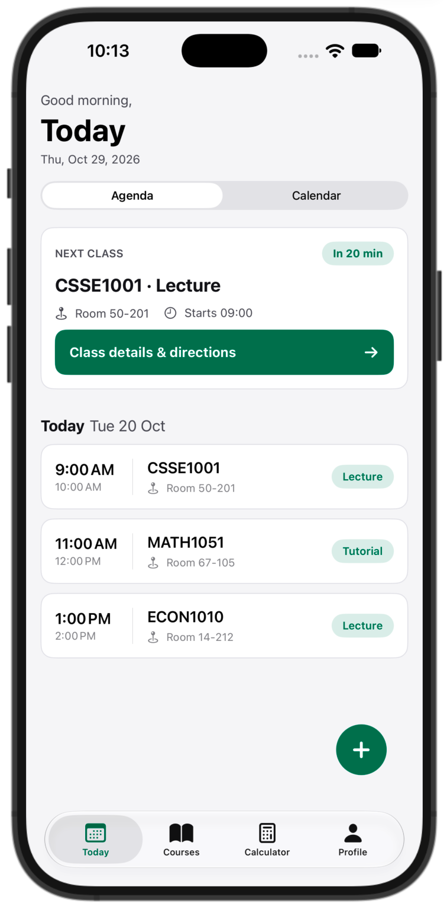
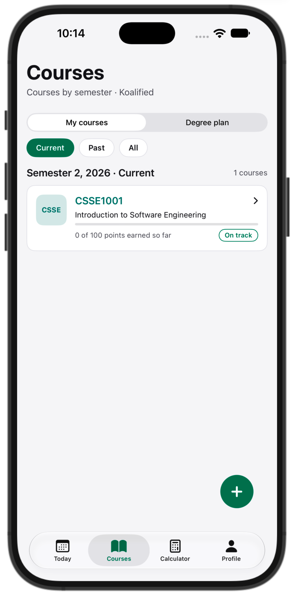

# Koalified

A campus planner for UQ students: classes, courses and assessments, a deadline calendar, reminders, a Home Screen widget and a target-grade calculator. Built with SwiftUI and SwiftData. Everything stays on the device: no accounts, no backend.

> Not an official UQ app. Grades and dates come from what the student enters or imports. The ECP and Blackboard are the source of truth.

  
  

*The Today agenda currently uses sample data until timetable import is wired in.*

## What works now
- **Courses and assessments:** add, edit and view courses (code, title, term, colour) and their assessments (weight, due date), stored with SwiftData.
- **Course detail:** marked and upcoming assessments, marked average.
- **Calendar:** month grid with deadline and drop-date markers, plus a "Coming up" list for the selected day.
- **Reminders:** local notifications the day before each unmarked assessment is due. A rolling window stays under iOS's limit of 64 pending notifications and refreshes whenever data changes or the app comes to the foreground.
- **Widget:** a Home Screen widget reading the same database through an App Group, refreshed when data changes.
- **Languages:** String Catalog with 8 languages (English, Simplified and Traditional Chinese, Hindi, Indonesian, Korean, Vietnamese, Japanese). Translations are machine-generated and need native review.
- **Onboarding:** language choice, year of study and timetable help.

## In progress
- Timetable import from a UQ `.ics` file (parser, file picker, matching sessions across re-imports)
- Today agenda and class reminders from real data
- Calculator and degree plan on real data (screens built, logic not wired yet)
- Settings, export and backup, widget previews

## Tech
SwiftUI, SwiftData, WidgetKit (shared App Group store), UserNotifications. iPhone only, designed at 393 pt wide. Designs are in Figma.

Some decisions worth reading in the code:
- `AppStore` creates one `ModelContainer` in the App Group, so the app and the widget extension read the same database.
- `NotificationScheduler` computes reminders as plain values first, then schedules the nearest 60, so the logic can be tested without the notification centre.
- `AppSync.dataChanged` is the single place that saves, reschedules reminders and reloads widget timelines.

## Roadmap
1. v0.1 Prototype: tab shell, Today, Courses, course detail, marks, SwiftData storage
2. v0.5 Beta: `.ics` import, calendar, widgets, reminders, TestFlight
3. v1.0 App Store launch

## Privacy rules
- The app never asks for or handles UQ passwords.
- No scraping behind a login.
- All user data stays on the device.
- No secrets in this repo.

## Running it
Open `Koalified/Koalified.xcodeproj` in Xcode and run the **Koalified** scheme on an iPhone simulator or device. The widget and App Group need a signing team set for both targets.
